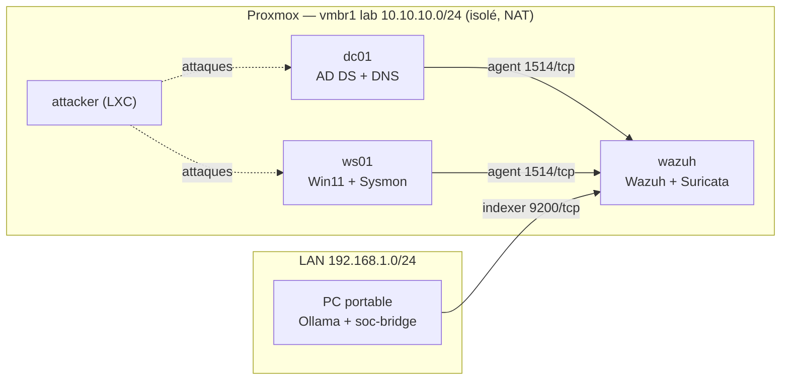

# SOC Lab — Wazuh + Sysmon + Suricata + triage LLM local

Lab SOC personnel hébergé sur Proxmox, avec un assistant de triage d'alertes
basé sur un LLM qui tourne en local (Ollama). L'objectif est de **mesurer**
ce que le lab détecte (couverture MITRE ATT&CK) et ce que vaut le LLM sur le
triage (précision / rappel), pas seulement d'empiler des outils.

> Statut : **semaine 2 terminée** — domaine AD, Sysmon et agents Wazuh en place (voir [CHANGELOG](CHANGELOG.md)) · prochaine étape : validation de la chaîne de détection Sysmon → Wazuh

## Architecture

Résumé (détails, plan IP et budget RAM dans [docs/architecture.md](docs/architecture.md)) :

| Machine | Rôle | Où |
|---|---|---|
| PC portable (RTX 4050 6 Go) | Ollama (Llama 3.1 8B, Qwen, Mistral) + `soc-bridge` | LAN |
| Serveur Proxmox (i5-9400F, 16 Go) | Hyperviseur du lab | LAN |
| VM `wazuh` | Wazuh manager / indexer / dashboard + Suricata (IDS) | LAN + lab |
| VM `dc01` | Contrôleur de domaine AD (Windows Server 2022 Core) | lab |
| VM `ws01` | Poste Windows 11 joint au domaine (Sysmon, Atomic Red Team) | lab |
| LXC `attacker` | Nmap, Hydra, Impacket | lab |



## Feuille de route

| Phase | Contenu | Livrable | Statut |
|---|---|---|---|
| S1 | Snapshot, dépôt, réseau lab, VM Windows | Dépôt + schéma | ✅ terminé |
| S2–S3 | Domaine AD, Sysmon, agents Wazuh | Captures d'alertes Sysmon + config versionnée | 🟡 S2 faite, S3 en cours |
| S4 | Suricata (ET Open) → Wazuh | Tableau « attaque → détecté par quoi » | ⬜ |
| S5–S6 | Atomic Red Team + Kerberoasting | Matrice de couverture ATT&CK + angles morts | ⬜ |
| S7–S8 | Évaluation du pipeline LLM | Précision / rappel / FP + limites et sécurité | ⬜ |

Règle : si une phase déborde, on supprime la suivante plutôt que de bâcler.

## Organisation du dépôt

```
.
├── README.md               ← ce fichier
├── CHANGELOG.md            ← journal des modifications (daté)
├── PREREQUIS.md            ← installation côté PC (GPU, WSL2, Docker, Ollama)
├── docker-compose.yml      ← Ollama (GPU) sur le PC
├── soc-bridge/             ← pont Wazuh Indexer → Ollama → SQLite (+ dashboard Streamlit)
├── configs/                ← configs versionnées (sysmon, wazuh, suricata, proxmox)
└── docs/
    ├── architecture.md     ← schémas actuel/cible, plan IP, budget RAM
    ├── semaine-NN.md       ← compte rendu de chaque semaine
    ├── preuves/            ← sorties de commandes brutes (.txt) par semaine
    └── screenshots/        ← captures des interfaces graphiques
```

## Résultats

_À venir :_ matrice de couverture ATT&CK (S6), métriques du classifieur LLM (S8).

## Limites et sécurité du pipeline

_À rédiger en semaine 8_ (injection de prompt via un champ de log, hallucinations,
données envoyées au modèle, etc.).
