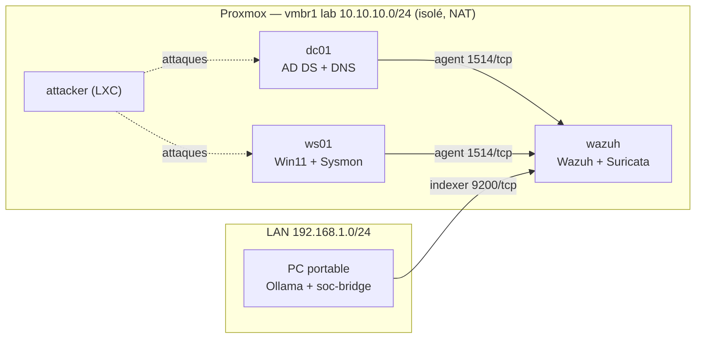

# SOC Lab — Wazuh + Sysmon + Suricata + triage LLM local

Lab SOC personnel hébergé sur Proxmox, avec un assistant de triage d'alertes
basé sur un LLM qui tourne en local (Ollama). L'objectif est de **mesurer**
ce que le lab détecte (couverture MITRE ATT&CK) et ce que vaut le LLM sur le
triage (précision / rappel), pas seulement d'empiler des outils.

> Statut : **semaine 4 terminée** — Suricata en écoute sur le lab (règles ET Open), bruit `STREAM` éteint, gravité des alertes alignée sur Emerging Threats, conteneur attaquant prêt (voir [compte rendu](docs/semaine-04.md) et [CHANGELOG](CHANGELOG.md)) · prochaine étape : tests offensifs depuis `attacker` et matrice de couverture ATT&CK (S5-S6)

## Architecture

Résumé (détails, plan IP et budget RAM dans [docs/architecture.md](docs/architecture.md)) :

| Machine | Rôle | Où |
|---|---|---|
| PC portable (RTX 4050 6 Go) | Ollama (Llama 3.1 8B, Qwen, Mistral) + `soc-bridge` | LAN |
| Serveur Proxmox (i5-9400F, 16 Go, VM du lab sur SSD) | Hyperviseur du lab | LAN |
| VM `wazuh` | Wazuh manager / indexer / dashboard + Suricata (IDS) | LAN + lab |
| VM `dc01` | Contrôleur de domaine AD (Windows Server 2022 Core) | lab |
| VM `ws01` | Poste Windows 11 joint au domaine (Sysmon, Atomic Red Team) | lab |
| LXC `attacker` | Nmap, Hydra, Impacket | lab |



## Feuille de route

| Phase | Contenu | Livrable | Statut |
|---|---|---|---|
| S1 | Snapshot, dépôt, réseau lab, VM Windows | Dépôt + schéma | ✅ terminé |
| S2–S3 | Domaine AD, Sysmon, agents Wazuh, validation de la chaîne de détection | Captures d'alertes Sysmon + config versionnée | ✅ terminé |
| S4 | Suricata (ET Open) → Wazuh | Matrice de visibilité « activité → détecté par quoi » (poste + réseau) | ✅ terminé |
| S5–S6 | Atomic Red Team + Kerberoasting | Matrice de couverture ATT&CK + angles morts | ⬜ |
| S7–S8 | Évaluation du pipeline LLM | Précision / rappel / FP + limites et sécurité | ⬜ |

Règle : si une phase déborde, on supprime la suivante plutôt que de bâcler.

## Organisation du dépôt

```
.
├── README.md               ← ce fichier
├── CHANGELOG.md            ← journal des modifications (daté)
├── PREREQUIS.md            ← installation côté PC (GPU, WSL2, Docker, Ollama)
├── docker-compose.yml      ← Ollama (GPU) sur le PC
├── soc-bridge/             ← pont Wazuh Indexer → Ollama → SQLite (+ dashboard Streamlit)
├── configs/                ← configs versionnées (sysmon, wazuh, suricata, proxmox)
│   └── wazuh/rules/        ← règles Wazuh locales + leurs tests hors ligne
└── docs/
    ├── architecture.md     ← schémas actuel/cible, plan IP, budget RAM
    ├── semaine-NN.md       ← compte rendu de chaque semaine
    ├── preuves/            ← sorties de commandes brutes (.txt) par semaine
    └── screenshots/        ← captures des interfaces graphiques
```

## Résultats

### Semaine 4 — détection réseau (Suricata) ajoutée à la chaîne

Suricata, hérité de la S2 où il capturait le LAN domestique, a été reconfiguré
pour le lab et branché sur Wazuh ([détail](docs/semaine-04.md)) :

| Mesure | Résultat |
|---|---|
| Bruit `SURICATA STREAM` | ~22 000 alertes/jour (S2) → **1 en 2 jours** |
| Chaîne trafic → Suricata → Wazuh | validée en ~5 s |
| Perte de paquets à la capture | 0 (0,00 %) sur 236 469 paquets |
| Gravité des alertes | alignée sur Emerging Threats (règles 100200-100202, niveaux 7/10/12) au lieu d'un niveau 3 uniforme |

Points clés :

- **Mode hub** (`bridge-ageing 0` sur `vmbr1`) : la VM Wazuh voit tout le trafic
  est-ouest du lab, équivalent virtuel du port mirroring / TAP du monde physique
  ([section 1](docs/semaine-04.md#1-état-initial-et-mode-hub)).
- **Deux points d'observation** : poste (Sysmon) et réseau (Suricata) se
  complètent sans se recouvrir — d'où la matrice de visibilité
  ([section 7](docs/semaine-04.md#7-matrice-de-visibilité--activité--détecté-par-quoi)).
- **Réglages de capture** : GRO/GSO/TSO coupés (cause du bruit `STREAM`) et
  `tpacket-v3` activé, par un drop-in systemd et `suricata.yaml` versionnés.
- **Conteneur `attacker`** (LXC, 512 Mo) prêt pour les tests réseau des S5-S6.

### Semaine 3 — premier test de la chaîne de détection

Reconnaissance bénigne lancée par un utilisateur standard du domaine sur `ws01`
([détail](docs/semaine-03.md#3-test-de-la-chaîne-de-détection)) :

| Mesure | Résultat |
|---|---|
| Commandes journalisées par Sysmon | 5 sur 6 (`nltest /dclist` manquant) |
| Commandes alertées explicitement par Wazuh | 2 sur 6, en niveau 3 |
| Alerte la plus grave de la fenêtre | faux positif de niveau 15 (fichier de test de PowerShell) |
| Délai événement → alerte | ~3 s |

Actions qui en découlent :

- **Angle mort `nltest`** : défaut de la config sysmon-modular (`nltestrk.exe`
  non couvert). Corrigé par une règle Sysmon locale et la règle Wazuh 100100
  (niveau 8) ([section 4](docs/semaine-03.md#4-angle-mort-nltest--cause-et-correction)).
- **Bruit** : 24 alertes PowerShell par jour (niveaux 9 à 15) et ~1 000 alertes
  par mise à jour de OneDrive, filtrées par deux règles de niveau 0 et vérifiées
  en conditions réelles : 26 fichiers créés, 0 alerte
  ([section 5](docs/semaine-03.md#5-réglage-du-bruit)).
- **Infrastructure** : passage des VM sur SSD, démarrage de l'indexer Wazuh
  274 s → 19 s ([section 2](docs/semaine-03.md#2-passage-sur-ssd)).

_À venir :_ matrice de couverture ATT&CK (S6), métriques du classifieur LLM (S8).

## Limites et sécurité du pipeline

_À rédiger en semaine 8_ (injection de prompt via un champ de log, hallucinations,
données envoyées au modèle, etc.).
