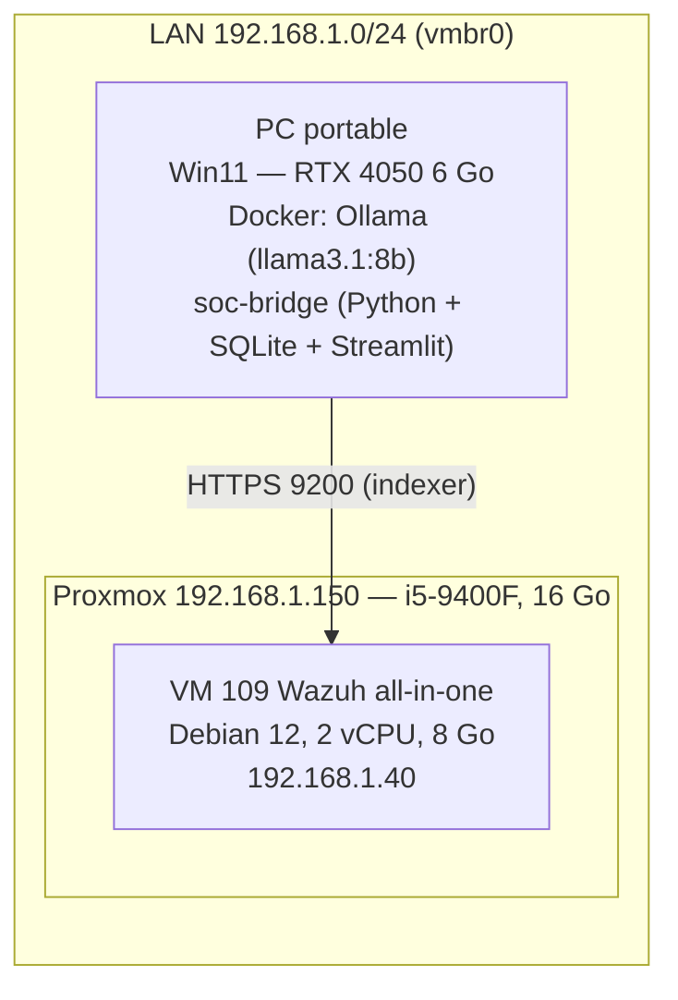
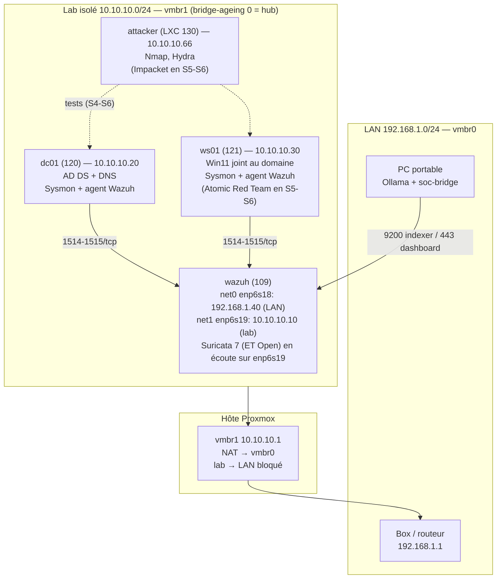

# Architecture

## 1. État actuel (avant le projet)

Inventaire du 2026-10-07 : Proxmox VE 9.2.21 (noyau 7.0.14-20-pve), 15 Gio
de RAM + 8 Gio de swap. Un seul bridge `vmbr0` (sur `enp2s0`), hôte en
`192.168.1.150/24`, passerelle `192.168.1.1`. Stockage `local` (dir, 72 Go
libres) et `local-lvm` (**lvm-thin**, 172 Go libres → snapshots possibles).

| VMID | Nom | OS | vCPU | RAM | Disque | Réseau |
|---|---|---|---|---|---|---|
| 109 | Wazuh | Debian 12 (q35, CPU host) | 2 | 8 Go → 5 Go → **6 Go** | 42 Go `local-lvm` → `ssd` (S3) | `net0` virtio sur `vmbr0` (firewall=1) |

Les autres VM de l'hôte sont d'anciens projets, hors périmètre ; elles restent
éteintes pendant le lab.

## 2. Architecture du lab (en place depuis la semaine 4)

### Choix d'architecture

- **Réseau lab isolé (`vmbr1`)** : les attaques et Atomic Red Team restent
  dans le lab. Le lab sort sur Internet via NAT de l'hôte (mises à jour,
  téléchargements) mais **ne peut pas joindre le LAN** (règle `FORWARD DROP`).
- **Wazuh à deux pattes** : une interface LAN pour que le PC accède au
  dashboard/indexer, une interface lab pour les agents. Aucun routage entre
  les deux sur la VM (`net.ipv4.ip_forward=0`).
- **`bridge-ageing 0` sur `vmbr1`** : le bridge oublie immédiatement les
  adresses MAC et inonde toutes les trames sur tous les ports, comme un hub.
  L'interface lab de la VM Wazuh voit donc tout le trafic du lab → Suricata
  peut tourner sur la VM Wazuh, sans VM ni port mirroring dédiés. Vérifié en
  S4 : trafic `ws01` ↔ `dc01` capturé, réponses ARP unicast comprises.
  **Raccourci de lab** : en entreprise, la sonde reçoit une copie du trafic par
  port mirroring (SPAN, sur le commutateur) ou par un TAP réseau.
- **Suricata sur la VM Wazuh** (S4) : capture AF_PACKET sur `enp6s19`,
  `HOME_NET` = 10.10.10.0/24, règles ET Open. Un drop-in systemd coupe
  GRO/GSO/TSO avant chaque démarrage (sinon les paquets fusionnés par la carte
  réseau génèrent des milliers de fausses alertes `STREAM`). Coût : ~570 Mo de
  RAM. Les alertes sont rattachées à l'agent `WAZUH` (la sonde) ; leur niveau
  suit la gravité Emerging Threats (règles locales 100200-100202).
- **Attaquant en LXC** (S4) : environ 512 Mo au lieu de 2 à 4 Go pour une VM
  Kali. Conteneur non privilégié, disque sur le SSD, non démarré avec l'hôte.
- **VM du projet sur SSD** (depuis la S3) : disques de `wazuh`, `dc01`, `ws01`
  (et `attacker` depuis la S4) sur le stockage lvm-thin `ssd` (Kingston A400 480 Go, SATA). Le SSHD d'origine
  garde Proxmox, les ISO et les VM hors périmètre. Démarrage de l'indexer avec
  les Windows en marche : 274 s → 19 s.
- **LLM hors Proxmox** : le PC portable fait l'inférence (6 Go de VRAM). Pour
  l'évaluation (S7–S8), les alertes sont exportées en JSONL ; pas besoin que le
  PC soit connecté au lab en permanence.

## 3. Plan d'adressage

| Hôte | Interface | IP | Passerelle | DNS |
|---|---|---|---|---|
| Hôte Proxmox | vmbr0 | 192.168.1.150 | 192.168.1.1 | box |
| Hôte Proxmox | vmbr1 | 10.10.10.1/24 | — | — |
| wazuh | enp6s18 (vmbr0) | 192.168.1.40 | 192.168.1.1 | box |
| wazuh | enp6s19 (vmbr1) | 10.10.10.10/24 | aucune | — |
| dc01 | vmbr1 | 10.10.10.20/24 | 10.10.10.1 | 127.0.0.1 (redirecteur 1.1.1.1) |
| ws01 | vmbr1 | 10.10.10.30/24 | 10.10.10.1 | 10.10.10.20 |
| attacker | vmbr1 | 10.10.10.66/24 | 10.10.10.1 | 10.10.10.20 |

Domaine AD : `soclab.internal` (NetBIOS `SOCLAB`). `.internal` est réservé à
l'usage privé et évite les conflits mDNS de `.local`.

## 4. Budget RAM (hôte 16 Go)

| Élément | RAM | vCPU | Notes |
|---|---|---|---|
| Hôte Proxmox | ~1,5 Go | — | KSM actif (partage des pages entre les 2 Windows) |
| wazuh (+ Suricata) | 6 Go | 2 | heap indexer limitée à 2 Go (`jvm.options`) ; 5 Go en S1, 6 Go depuis la S3 ; Suricata ~570 Mo (S4), 1,6 Gio restants dans la VM |
| dc01 (Server 2022 Core) | 2 Go | 2 | pas d'interface graphique |
| ws01 (Win11) | 4 Go max / 2 Go min | 2 | ballooning ; 4 Go requis à l'installation |
| attacker (LXC Debian 12) | 512 Mo | 1 | + 512 Mo de swap ; allumé seulement pendant les tests |
| **Total** | **~14 Go** | 7 / 6 cœurs | marge ~2 Go |

Mesure S4, les 4 machines allumées : 3,1 Gio de RAM disponibles sur l'hôte.
